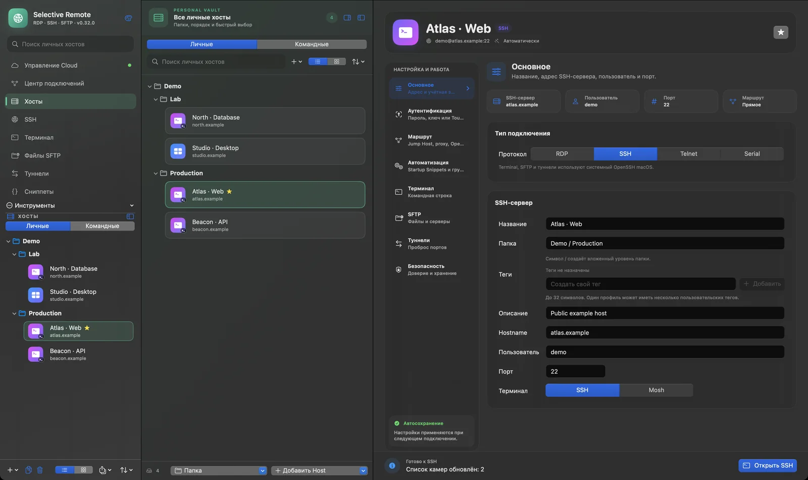
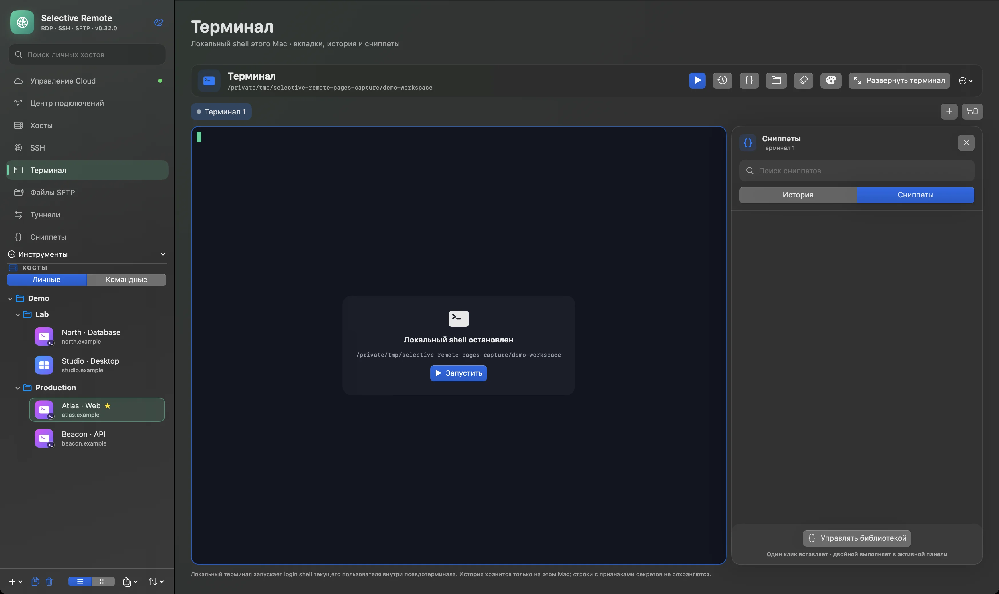
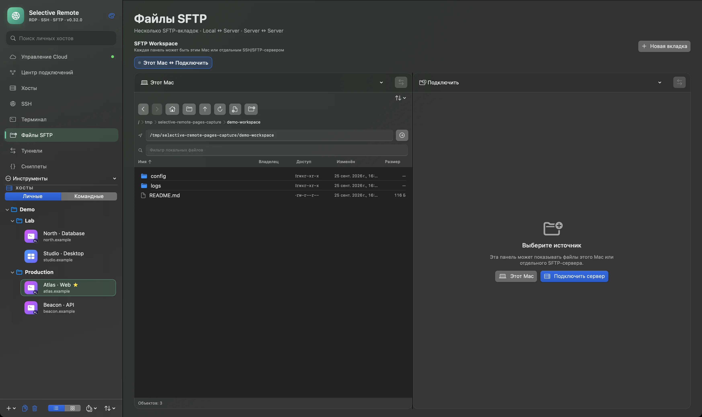
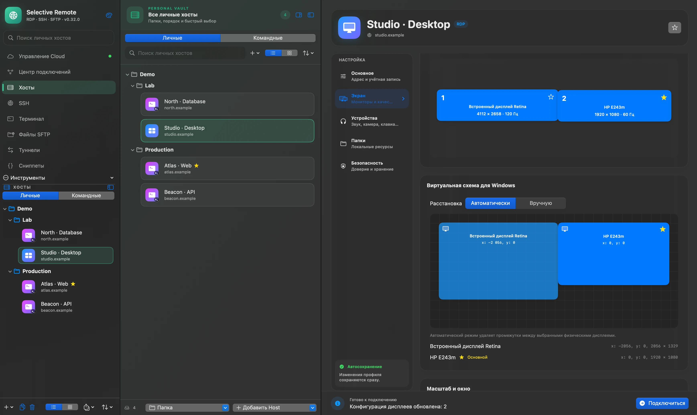

<h1 align="center">Selective Remote</h1>

SSH, RDP, SFTP и туннели в одном приложении для Mac.

  <strong><a href="https://github.com/PastFly/Selective-Remote/releases/latest">Скачать для Mac</a></strong> ·
  <a href="https://pastfly.github.io/Selective-Remote/ru/">Сайт</a> ·
  <a href="https://cloud.pastfly.ru/">Cloud</a> ·
  <a href="README_EN.md">English</a>

Community · Apple silicon · macOS 15+ · Лицензия MIT

*Снимок приложения версии 0.32.0 (163) с демонстрационными данными.*

## Подключения и инструменты

- **Подключения.** SSH, RDP, Telnet и Serial. Профили, группы, теги и избранное помогают найти нужный хост.
- **Терминал и команды.** Вкладки, разделение на панели, Snippets для SSH и локального терминала.
- **Файлы и туннели.** Двухпанельный SFTP для передачи файлов между Mac и сервером или между двумя серверами. Управление SSH-туннелями и диагностика подключений.
- **RDP на нескольких дисплеях.** Выберите мониторы Mac и задайте их порядок для каждого профиля.

Терминал, SFTP и настройка дисплеев RDP

[Все возможности](docs/FEATURES-RU.md) · [RDP на нескольких мониторах](https://pastfly.github.io/Selective-Remote/guides/multi-monitor-rdp-macos.html) · [SFTP между серверами](https://pastfly.github.io/Selective-Remote/guides/server-to-server-sftp-macos.html)

## Синхронизация через Cloud

**Personal Vault** синхронизирует хосты, учётные данные и Snippets между доверенными Mac и браузерами. **Team Vaults** поддерживают общие данные, приглашения и роли. Центр синхронизации показывает состояние Vault и помогает проверить конфликты и доступ устройств. Доступность синхронизации зависит от настроек Cloud и прав аккаунта.

Данные Vault шифруются на устройстве. Selective Remote использует Связку ключей macOS, проверяет ключи SSH-хостов и шифрует полные локальные резервные копии. Для локальной работы аккаунт Cloud не требуется.

[Открыть Cloud](https://cloud.pastfly.ru/) · [Архитектура Cloud](docs/cloud-v0.32-architecture.md) · [Политика безопасности](SECURITY.md)

## Установка

1. Скачайте DMG для Apple silicon из [актуального релиза](https://github.com/PastFly/Selective-Remote/releases/latest). Требуется macOS 15 или новее.
2. Сверьте SHA-256 с файлом контрольной суммы рядом с DMG.
3. Откройте DMG и перетащите **Selective Remote** в папку «Программы».

Сборка Community использует ad-hoc подпись. Приложение может скачать обновление и проверить его SHA-256. Установка из DMG выполняется вручную. Если macOS попросит подтвердить запуск, следуйте инструкции Apple. [Запуск приложений в macOS](https://support.apple.com/en-gb/102445)

[История изменений](CHANGELOG.md) · [Сборка из исходников](BUILD-RU.md) · [Telegram](https://t.me/SelectiveRemoteApp) · [Поддержать проект](SUPPORT.md)
