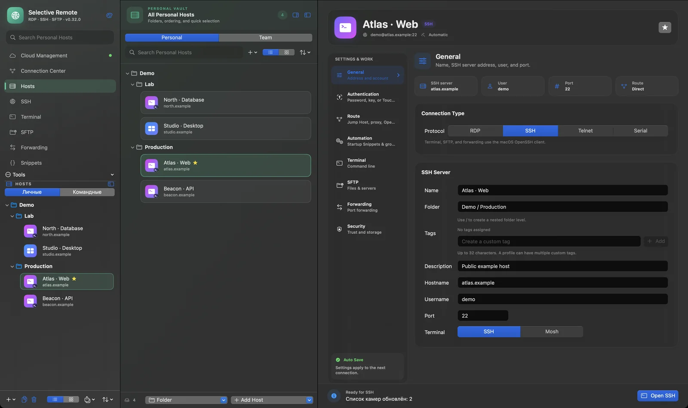
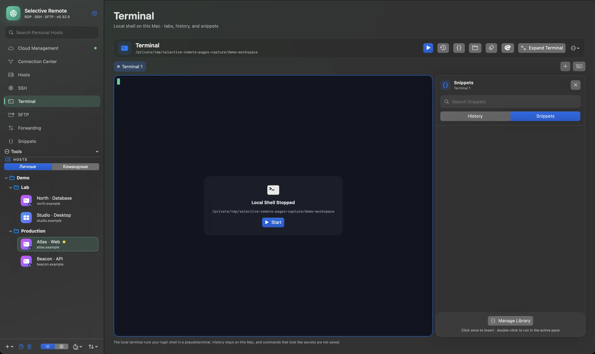
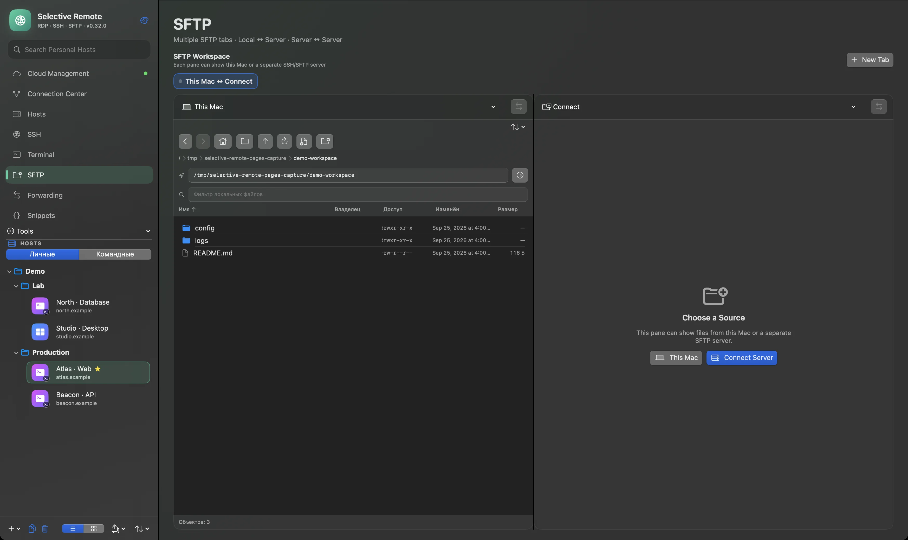
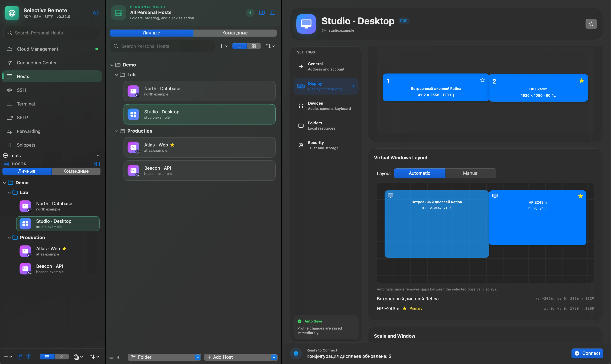

<h1 align="center">Selective Remote</h1>

SSH, RDP, SFTP, and tunnels in one app for Mac.

  <strong><a href="https://github.com/PastFly/Selective-Remote/releases/latest">Download for Mac</a></strong> ·
  <a href="https://pastfly.github.io/Selective-Remote/">Website</a> ·
  <a href="https://cloud.pastfly.ru/">Cloud</a> ·
  <a href="README.md">Русский</a>

Community · Apple silicon · macOS 15+ · MIT license

*Selective Remote 0.32.0 (163) with demo data.*

## Connections and tools

- **Connections.** SSH, RDP, Telnet, and Serial. Profiles, groups, tags, and favorites help you find the right host.
- **Terminal and commands.** Tabs, split panes, and reusable Snippets for SSH and local terminal sessions.
- **Files and tunnels.** Dual-pane SFTP transfers between your Mac and a server or between two servers. Manage SSH tunnels and check connection diagnostics.
- **RDP across displays.** Choose and arrange your Mac displays for each remote desktop profile.

Terminal, SFTP, and RDP display settings

[All features](docs/FEATURES-EN.md) · [Multi-monitor RDP](https://pastfly.github.io/Selective-Remote/guides/multi-monitor-rdp-macos.html) · [Server-to-server SFTP](https://pastfly.github.io/Selective-Remote/guides/server-to-server-sftp-macos.html)

## Cloud sync

**Personal Vault** syncs hosts, credentials, and Snippets across trusted Mac and browser devices. **Team Vaults** support shared data, invitations, and roles. Sync Center shows Vault status and helps you review conflicts and device access. Sync availability depends on your Cloud configuration and account permissions.

Vault data is encrypted on the device. Selective Remote uses macOS Keychain, verifies SSH host keys, and encrypts full local backups. You can work locally without a Cloud account.

[Open Cloud](https://cloud.pastfly.ru/) · [Cloud architecture](docs/cloud-v0.32-architecture.md) · [Security policy](SECURITY.md)

## Installation

1. Download the Apple silicon DMG from the [latest release](https://github.com/PastFly/Selective-Remote/releases/latest). Requires macOS 15 or later.
2. Check its SHA-256 digest against the checksum file next to the DMG.
3. Open the DMG and drag **Selective Remote** into Applications.

Community builds use ad-hoc signing. The app can download updates and verify their SHA-256 digest. Install manually from the DMG. If macOS prompts you to confirm the launch, follow Apple’s instructions. [Opening apps on macOS](https://support.apple.com/en-gb/102445)

[Changelog](CHANGELOG_EN.md) · [Build from source](BUILD-RU.md) · [Telegram](https://t.me/SelectiveRemoteApp) · [Support the project](SUPPORT.md#english)
